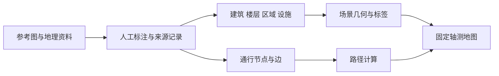

# 大阪梅田立体交互地图：可行性与实现方案

评估日期：2026-11-14。状态：方案草案，已开始局部样板；本文中的规模、工期和性能数值均为规划目标，尚无浏览器性能实测。当前实现与运行方式见根目录 [README](../README.md)。

## 1. 结论与关键判断

方案可行。建议做成一张可拆解、可查看通道关系的风格化立体导览图：固定正等轴测方向，允许平移、缩放、楼层展开和设施点选。

首期采用 Three.js 的正交相机，将人工整理的楼层轮廓、通道、站台和设施生成轻量 3D 几何。外景强调标志性轮廓与材质层次，室内强调可读性。导航使用独立的节点与边，不从屏幕图形或模型碰撞关系临时推导。

现有资料足以启动示意级重建，但不是测绘模型。主要难点是：

1. 参考图已经做过透视、分层位移和示意变形，不能直接按图中距离恢复世界坐标。
2. 闸内外、跨层设施和两站之间的通行关系，需要逐条标注和核对。
3. 多层、多建筑同时展开时，必须控制遮挡和标签密度。

建议先完成一个小而完整的样板，验证视觉、HTML 入口与资源打包与跨层路径，再扩充地图，避免先投入两站全部细节。

## 2. 产品范围

### 首期地图

统一站名：JR 大阪站（JR Osaka Station）与阪急大阪梅田站（Hankyu Osaka-umeda）。不要与阪神大阪梅田站、地铁梅田站合并为同一个站点。

| 内容 | 首期处理 |
| --- | --- |
| 两站外部轮廓与相对位置 | 必须；统一坐标和朝向 |
| 站厅、站台、主要公共通道 | 必须；允许简化非关键边界 |
| 闸机、售票处、售票机、扶梯、楼梯、直梯 | 必须有对应语义类型；先覆盖主干路线涉及的设施 |
| 两站间连接 | 核实至少一条连续步行路径；不能仅用一条跨建筑直线代替 |
| 屋顶与外壳 | 表现具有辨识度的倾斜大屋顶等结构；目标归属和形态先核对资料 |
| 周边商场 | 可有低细节外壳与名称作为方位参照，不承诺已有内部导航 |
| JR 西侧、梅北地下区域 | 保留数据扩展能力；首期可只做边界入口，不默认覆盖全部地下站台 |
| 施工关闭 | 按用户要求，本阶段忽略临时施工关闭，研究基础通行结构 |

“覆盖两站”指主干布局和可核对的关键设施，不代表每个商铺、闸机单元和楼梯都已完整建档。页面应明确标出覆盖边界。

### 后续扩展

按“连接入口 → 通行骨架 → 必要楼层 → 设施细节”的顺序扩展大丸梅田店、阪急百货梅田本店、Yodobashi 等区域。优先解决地下通路和二层连廊，不先建商场全楼层。

每个连接必须确认两个端点、所属建筑、楼层、通行类型和闸内外属性。附近建筑之间不能因空间相邻就自动连通。

### 首期暂不纳入

实时室内定位、列车时刻与换乘计费、人流预测、营业状态同步、自由旋转漫游、精确距离或步行时长承诺、完整商业 POI 数据库。用户手动选择起终点即可。

## 3. 视觉与交互

### 视觉方向

采用“室内导览配色 + 建筑拆解模型”的表现方式：暖白背景、低饱和地板、浅灰外壳、适度厚度与侧面明暗，少量柔和阴影。无需照片纹理、写实玻璃反射和复杂材质。

建议色板仅作为起点，须在样板上检验：

| 语义 | 建议颜色 | 额外识别方式 |
| --- | --- | --- |
| 可步行公共区 | 米白 `#EEE5D2` | 实体地板轮廓 |
| 站台 | 浅蓝灰 `#D3E3EC` | 站台号与轨道边界 |
| 付费区 | 浅青绿 `#D9E8DF` | 闸机边界与文字 |
| 商业体 | 浅暖粉 `#ECD8D4` | 名称与建筑边界 |
| 扶梯、楼梯、直梯 | 蓝色 `#426A8C` | 分别使用斜坡、台阶、竖井图形 |
| 选中路线 | 橙红 `#D95735` | 箭头、端点与跨层提示 |

不要只依赖颜色表达设施或通行权限。售票处表现为柜台，售票机表现为机柜，闸机表现为成组短柱；相同设施共享简化模型。复杂小图标优先用屏幕空间标签呈现。

### 三种视图状态

1. **总览**：两站与周边低细节外壳同屏，突出位置、站名和主要出入口。
2. **分层展开**：屋顶单独抬升或隐藏，楼层沿竖直方向拉开；显示楼层名、跨层设施和通道骨架。
3. **楼层聚焦**：选中建筑的某层，其他楼层隐藏或弱化；设施标签按优先级显示。

只允许固定方向的平移与缩放，不提供自由旋转。展开程度可以用一个滑杆控制。展开时按新包围盒重新适配视野，不能把上层推出手机屏幕。

路线视图不增加新的地图坐标：选中起终点后高亮路线，自动展开涉及楼层，并给出“经过某闸口 → 上/下楼 → 抵达某站台”的步骤。被隐藏楼层上的路线用明确的跨层提示表达。

### 手机端操作

- 单指拖动平移，双指缩放，点选设施；拖动结束不误触选中。
- 楼层选择与起终点设置使用底部面板；收起后保留地图空间。
- 提供复位、展开/收拢、屋顶显隐、设施筛选与图例。
- 地图中的小设施使用放大的点击区域；也可从列表选择，避免必须点中细小 3D 模型。
- 屏幕标签保持正向，按缩放级别显示并做碰撞避让；不把官方图上全部文字搬上首屏。
- 支持减少动画偏好；设施列表和导航步骤可通过键盘访问。

## 4. 渲染方案比较

| 方案 | 优点 | 本项目的主要代价 | 判断 |
| --- | --- | --- | --- |
| SVG / Canvas 2.5D | 固定角度下容易画导览图；SVG 可直接响应点选 | 多层遮挡、倾斜屋顶与动态展开的深度排序需要自行处理 | 适合静态验证图或备用示意图 |
| Three.js 轻量 3D | 楼层和屋顶具有真实深度关系；几何、相机与选择逻辑可控 | 需要管理 WebGL、标签和移动端性能 | **推荐首期主方案** |
| MapLibre 等地理地图引擎 | 容易接地理底图、建筑轮廓与地图操作 | 自定义拆解、设施模型和固定轴测构图仍需额外实现 | 暂不作为主渲染器 |
| 导入整片城市/BIM 模型 | 外部体量可能更完整 | 数据体积、室内语义缺失、裁剪和风格统一成本 | 只作为局部参考来源 |

Three.js 的 [OrthographicCamera](https://threejs.org/docs/pages/OrthographicCamera.html) 提供正交投影，[ExtrudeGeometry](https://threejs.org/docs/pages/ExtrudeGeometry.html) 可将轮廓拉伸为几何，[Raycaster](https://threejs.org/docs/pages/Raycaster.html) 可用于点选。上述能力支持本方案，工程量判断属于本项目评估。

以 Y 轴向上为约定，严格正等轴测采用相对场景轴的水平 45°、俯视约 35.264°，相机方向分量绝对值相等。按用户习惯固定轨道为画面左下至右上走向。局部样板暂以 X 向东、Z 向南约定，选取相机方向 `(-1, 1, 1)`，北投影至左上、南投影至右下；常驻方位指示明确标为示意，后续地理校准时同步更新。

外壳、屋顶和各层使用独立分组；屋顶采用低面数斜面及简化支架。优先隐藏遮挡外壳，而不是依赖大量半透明表面，避免透明排序和阅读困难。首期不需要 Blender 才能完成基础模型；复杂地标可以后续离线建模、简化后导入。

用户提供的外景照片进一步明确了大屋顶的造型方向：宽大倾斜屋面、浅色厚边、重复采光带与下方三角桁架，以及其覆盖平行站台雨棚的关系。局部样板应优先验证这些特征在低面数、无照片纹理的条件下是否仍有辨识度。照片用于形态参考，精确朝向、尺寸和地理关系另行核对，详见[外景参考记录](./references-and-community.md)。

## 5. 数据结构与空间对齐

### 三套数据分开维护



- **语义地图**：建筑、楼层、区域轮廓、轨道、设施与门户。
- **通行图**：节点、边、方向、闸内外和跨层关系。
- **显示状态**：选中层、展开量、缩放、屋顶显隐、标签优先级。

### 建议实体

| 实体 | 关键字段 |
| --- | --- |
| Building | `id`、名称、局部坐标变换、地理锚点、外轮廓、地标外壳 |
| Level | `id`、`buildingId`、楼层标识、基础高程、展开排序、区域集合 |
| Area | `id`、`levelId`、类型、多边形及孔洞、付费区域标识 |
| Facility | `id`、类型、`levelId`、位置与朝向、关联通行节点、显示名称 |
| Portal | `id`、两端节点、连接类型、所属设施、核对状态 |
| RouteNode | `id`、`levelId`、位置、区域/付费域 |
| RouteEdge | `id`、两端节点、折线、类型、方向、长度或代价、权限、核对状态 |
| Source | `id`、本地路径或 URL、来源日期、页码/图中标记、核对时间、备注 |

地图实体和关键通行边都记录 `sourceIds`、`confidence`（已核对/推断/未知）。没有确认的连通关系不进入默认导航。

### 建筑位置与室内坐标

Google 地图或 OSM 可用于相对位置核对；优先从可取得的 OSM 数据整理建筑轮廓与地理锚点。本轮尚未提取梅田区域 OSM 几何和坐标，也未核实其室内覆盖度。

建议流程：

1. 选地区公共原点，将经纬度投影到适合局部地区的平面米制坐标，再映射为场景 X/Z；保存投影和轴向约定。
2. 为每栋建筑记录平移、旋转及必要的尺度转换，确保相对朝向与街区关系一致。
3. 每层单独从参考图整理局部轮廓，再用多个稳定控制点对齐：建筑角、站台端部、出入口或竖向设施。
4. **参考图已经分层展开**，图中的楼层间偏移要去掉；不能把 PDF/SVG 像素坐标直接当成世界位置。
5. 保留几何对齐误差和示意简化说明；无法标定距离时使用示意坐标，路线不输出伪精确米数。

### 楼层标识与高度

`2F` 是建筑自己的楼层名称，不代表所有建筑的同一物理高度。JR 资料含夹层，同页也可能标出不同建筑的不同层。每个楼层使用独立 ID 和基础高程，楼层名称与高度分开保存；连廊通过两个具体端点连接。

展开只改变显示变换，例如 `displayY = baseY + bandIndex × explodeGap`。相连楼层可使用统一展开带保持阅读关系；导航仍使用原始楼层与路径，不用展开后的高度计算代价。跨层线和设施连接根据两端显示位置重绘。

## 6. 简单导航的实现边界

先做主要通道中心线图，使用 Dijkstra 等基础最短路算法即可；不需要整站导航网格或室内定位服务。边可以保存折线，路径沿实际通道绘制，而非只连接节点直线。

必须遵循：

- 同层线条交叉不自动创建交点；跨层通道必须显式通过楼梯、扶梯、直梯或坡道连接。
- 闸机两侧是不同付费状态；公共路线不得抄近路穿越付费区。去站台的路径允许在明确步骤中经过对应闸机，并提示入闸。
- 扶梯的上下行方向未知时不当作已确认双向通路；可先选择已核对楼梯路线。
- 导航只使用已核对的边。未知连接显示为地图边界或待核对，不生成完整可通行路线。
- 有向扶梯、通行限制和电梯停靠层属于数据属性，不写死在渲染逻辑里。
- 若没有已确认路线，返回“当前数据未覆盖此连接”，不能伪造绕行。

“优先直梯”的筛选可以在数据充足后加入；首期不能仅排除楼梯就宣称路线无障碍，还需确认端点和中间通道连续可达。施工关闭按本阶段约定不参与路径计算。

首期先验证三类路线：同层出入口到售票处、闸口经竖向设施到站台、JR 出口经公共连接到阪急入口。第三类必须在连接核实后纳入验收。

## 7. 单 HTML 入口与交付

应用代码确定采用 **TypeScript**，在 `src/` 中分模块维护，构建产物统一输出到 `dist/`，交付入口为 `dist/index.html`。根据用户补充，单入口不要求单文件，JS、CSS、模型和图片等资源可以独立加载。

```text
docs/                 方案与数据整理规范
references/           原始资料，保持不改动
src/                  TypeScript 应用源码及样式
  domain/             地图模型与导航领域规则
  application/        查看状态与路线用例协调
  infrastructure/     样板数据；后续增加资料导入适配
  presentation/       Three.js 场景及界面呈现
  utils/              通用工具
tests/                独立测试目录
scripts/              校验、几何生成与资源打包
dist/index.html       生成交付物，已在 .gitignore 中忽略
```

当前将应用和锁定版本的渲染依赖打包为 `dist/app.js`，样式输出到 `dist/styles.css`，由 HTML 通过相对路径加载。地图 JSON 目前随 JS 打包，后续可按区域拆分；模型和图片等资源按需加载。资源优先随项目部署，保留依赖许可证说明；首期仍优先程序化几何，减少下载体积。

通过静态 HTTP 服务进行主要验收，检查 HTML、JS、CSS 和后续资源路径均可加载；复制或部署时保留完整 `dist/`。`file://` 兼容性可另外验证，涉及后续 JSON 或模型加载时不保证双击文件即可使用；内置浏览器兼容性另测。

局部样板已采用 TypeScript、Three.js 与 esbuild；由 TypeScript 构建脚本分别生成入口、JS 与 CSS，不引入 UI 框架。

TypeScript 启用严格类型检查，为地图实体、通行图及显示状态定义明确类型。构建时将 TypeScript 转换并打包为浏览器可执行的 JavaScript，由 HTML 加载；交付文件不要求浏览器直接执行 TypeScript。类型检查命令为 `npm run typecheck`，构建命令为 `npm run build`。

`src/` 已加入局部样板实现，原目录占位文件已移除。`dist/` 已被 Git 忽略，可以随时删除并由构建重新生成；不直接编辑或提交其中的产物。

## 8. 性能与兼容性目标

以下只是首轮预算，需在代表性手机实测后调整：

| 指标 | 初始目标 |
| --- | --- |
| 首屏必要资源总量 | 尽量控制在 5 MB 内，不加载原始 PDF/SVG 作为地图 |
| 分层拖动与展开动画 | 代表性中端手机达到 30 FPS，桌面争取 60 FPS |
| 同屏标签 | 优先控制在约 40 个；按层与缩放动态裁剪 |
| 可见几何 | 初步预算 10 万三角形以内、约 150 draw calls 以内 |
| 标签、设施点击与状态切换 | 操作后及时反馈，无长时间主线程阻塞 |

采用共享几何与材质、重复设施实例化、按需渲染、动画结束停止循环、限制移动端像素比。首期不加入重型后处理。WebGL 不可用时显示可读的设施/路线信息与能力提示，不能只留白画布。

## 9. 阶段与验收

| 阶段 | 交付 | 验收重点 | 粗估工作量 |
| --- | --- | --- | --- |
| A：数据与风格样板 | 一个站局部两层、几类设施、简化屋顶、HTML 入口 | 固定轴测、层间展开、点选、手机操作、入口与资源加载 | 2–4 人日 |
| B：两站骨架 | 两站主要层、站台与公共通道、相对位置 | 对照资料核对主干；屋顶不遮挡室内；标签可读 | 4–7 人日 |
| C：连接与导航 | 跨层图、闸内外、至少一条已核实的站间路线 | 无穿墙/错误跨层/借付费区抄近路；无路可达时正确提示 | 3–5 人日 |
| D：统一与交付 | 配色、动画、性能整理、覆盖说明 | 移动与桌面检查、网络断开检查、文件体积与帧率记录 | 2–4 人日 |

合计约 11–20 人日，属于具备前端和建模能力情况下的初步估算，不是承诺。资料重绘、站间路线核实和风格迭代可能使工作量增加；商场内部与全部梅北区域未计入。

最小有价值原型是“两个楼层 + 一个跨层设施 + 一条能解释清楚的路径 + 一块标志性屋顶”。只有样板通过，才大量录入全站设施。

## 10. 开始实现前需要解决的具体问题

1. 为两站建立楼层/夹层清单，划定首期覆盖边界与外部门户。
2. 取得地区建筑轮廓或锚点，核实倾斜大屋顶归属、朝向与轮廓。
3. 人工整理一条两站之间的公共通行链，确认各楼层和闸内外关系。
4. 对屋顶、楼板、扶梯和标签做局部视觉样板，决定层间距与默认构图。
5. 对社区模型做小范围采样，确认是否真能减少建模时间；见[社区项目评估](./references-and-community.md)。

以上均可在后续原型工作中按建议默认推进，本轮不依赖额外审批，也不代表已完成数据核验。
